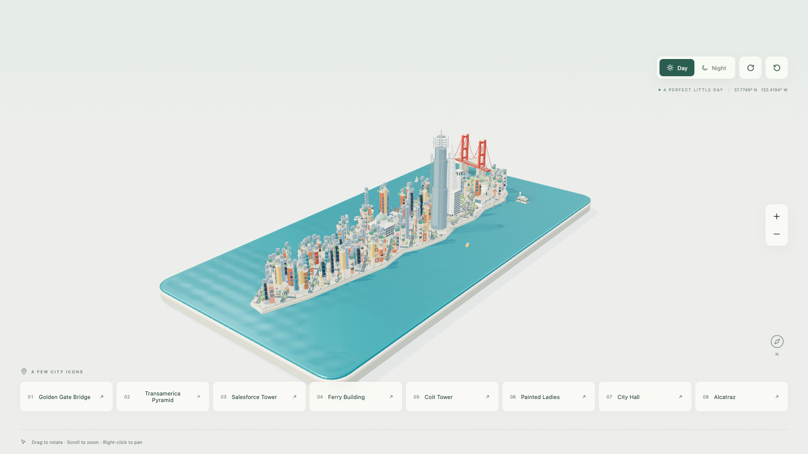

# City Miniature — an OpenCode skill

Build an interactive 3D miniature of a city as **one self-contained HTML file**: a street grid,
dedicated landmark models, traffic and boats, day/night lighting, and a landmark bar with camera
flights. Ships with a working San Francisco diorama as the template.



## What it produces

`dist-single/index.html` — roughly 1 MB, no external scripts, fonts, images or network calls. It runs
from disk, from a static host, or on GitHub Pages, and embeds in a 345×345 iframe.

The template's city, San Francisco, has eight landmarks (Golden Gate Bridge, Transamerica Pyramid,
Salesforce Tower, Ferry Building, Coit Tower, Painted Ladies, City Hall, Alcatraz), a rotated
downtown grid with Market Street cutting across it, Golden Gate Park, the Presidio, bay piers and
~200 street parcels.

## Install

Clone straight into the skills directory:

```sh
git clone https://github.com/somphol/city-miniature.git \
  ~/.config/opencode/skills/city-miniature
```

The skill ID is `city-miniature` (the directory name). Load it with `@city-miniature`, or add the
path to the `skills` array in any `opencode.json`:

```jsonc
{ "skills": ["~/Projects/city-miniature"] }
```

## Use

```sh
node scripts/new-project.mjs --out ~/my-miniature
cd ~/my-miniature
npm ci
npm run dev            # live editing
npm run build:single   # -> dist-single/index.html
node tests/run.mjs     # geometry, traffic, diversity, planning
node scripts/verify.mjs # driven interactions, frame-rate independent
```

`npm run shoot` is the deeper visual harness; it needs GPU-backed headless Chrome.

## What is in here

```text
SKILL.md                     workflow, module map, adaptation recipes
assets/san-francisco-diorama the working template (source, 45 files)
results/…/index.html         the published single-file build
references/method.md         construction order and invariants
references/lessons.md        the details that regress
references/verification.md   tests, verify.mjs, why shoot needs a GPU
references/hosting.md        GitHub Pages, CSP, URL parameters, embed handshake
references/build-log.md      why the template is shaped the way it is
scripts/new-project.mjs      scaffold a project from the template
```

## Adapting it to another city

Change the outline, the street frame, the landmark anchors and their models, the camera views and
the copy **together** — a new city with old coordinates reads as a reskin. `references/method.md`
lists the invariants; `references/build-log.md` records the dead ends so you do not repeat them.

## Provenance

The template derives from the Manhattan Miniature 0.2.0 sample (SandBase Lab), reworked into San
Francisco: new geography, street plan, eight landmark models, bilingual copy, roof detailing, traffic
lanes on the bridge, and a deterministic verification script.

Third-party licences for the bundled build are embedded in `results/*/index.html` and reproduced by
`npm run build:single` into `dist/THIRD_PARTY_NOTICES.txt`. The scene depends on React, three.js and
Vite (MIT) plus their transitive dependencies.
